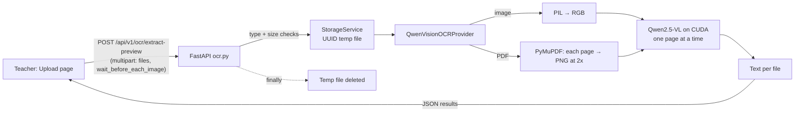

# LumenEIOS OCR Implementation

As of 2026-11-10 · Code paths are relative to `apps/lumeneios` in the arena repo (branch `sync/lumeneios-updates`).

LumenEIOS OCR today only previews text. A teacher uploads JPG, PNG or PDF answer sheets, and the backend transcribes them with Qwen2.5-VL-3B. Vast.ai uses the AWQ checkpoint; the Windows `run.bat` setup uses the standard checkpoint. The model runs inside the FastAPI process on a local NVIDIA GPU. OCR does **not** grade, store results or publish marks. Every mark still needs a teacher's sign-off.

## At a glance

Files are handled one after another. Each file is saved to a temporary path, transcribed and deleted, even if the transcription fails. Nothing is written to the database.

## OCR providers

Every provider implements one interface, `BaseOCRProvider.extract_document(path, options)`, in `backend/app/services/ocr_service.py`. `get_ocr_provider(name)` picks a provider by name.

| Name | Class | Real or simulated | Output | Used by |
|---|---|---|---|---|
| `qwen` | `QwenVisionOCRProvider` | **Real** (Qwen2.5-VL on GPU) | Plain text per file, with LaTeX for maths | `/ocr/extract-preview` |
| `simulated` (default) | `SimulatedOCRProvider` | Fixed demo data | 4 answer regions with boxes, confidence, suggested marks, competency | `/ocr/process`, batch grading |
| `trocr` | `TrOCRHuggingFaceProvider` | **Stub.** Returns the simulated data relabelled | Same as simulated | `/ocr/process` |
| `paddleocr` | `PaddleOCRProvider` | **Stub.** Returns the simulated data relabelled | Same as simulated | `/ocr/process` |

Only Qwen actually reads the image. TrOCR and PaddleOCR are placeholders.

## How the Qwen provider works

1. **Lazy load.** The model loads on the first request, not at startup. A single shared instance is used (`_qwen_provider`).
2. **Checks.** If `torch`, `transformers` or `qwen_vl_utils` is missing, or CUDA is not available, the provider raises `QwenOCRUnavailableError` and the API returns 503. It never quietly falls back to simulated output.
3. **Model setup.** It reads the model ID from `settings.QWEN_VL_MODEL_ID` (default `Qwen/Qwen2.5-VL-3B-Instruct`). The model loads in float16 with `device_map="auto"`. The processor uses `min_pixels = 512×28×28` and `max_pixels = 2048×28×28`.
4. **AWQ workaround.** `lm_head` is added to `modules_to_not_convert`. Without this, Transformers swaps in randomly initialised AWQ weights and the output is garbage.
5. **Input.** An image is opened with PIL and converted to RGB. A PDF is opened with PyMuPDF and each page is rendered to PNG at 2× zoom. PDFs are limited to 25 pages, and password-protected or empty PDFs are rejected.
6. **Prompt.** The model is told to extract only visible text and formulas, keep the original language without translating, write `[unclear]` instead of guessing, format maths in LaTeX, and add no commentary.
7. **Generation.** Greedy decoding (`do_sample=False`) with `max_new_tokens=2048` per page, under `torch.inference_mode()`.
8. **Serialisation.** A global `threading.Lock` lets only one page use the GPU at a time. Inference runs in `asyncio.to_thread` so it doesn't block the event loop.
9. **Optional pause.** If the teacher ticks "wait before each image", the provider sleeps 5 s before each image or page.
10. **Result.** Page texts are joined with blank lines. The provider returns `provider`, `model_version`, `extracted_text` and `pages_processed`.

## API endpoints

All routes are in `backend/app/api/v1/ocr.py` under `/api/v1/ocr`. Only `admin`, `principal` and `teacher` can call them. Students get 403.

| Method + path | Purpose | Notes |
|---|---|---|
| `POST /ocr/extract-preview` | Qwen OCR text preview | Form fields `files[]` and `wait_before_each_image`. Returns `{provider, model_version, results:[{file_name, extracted_text, pages_processed}]}`. Saves nothing. |
| `POST /ocr/process` | Runs a provider on a stored `Document` and saves an `OCRRun` with regions | Rejects `provider="qwen"` with 400, because Qwen gives text only, not regions. |
| `POST /ocr/review/verify` | Teacher-verified marks for a document | Human-in-the-loop step. Not called by the Qwen preview. |
| `/ocr/batches/...` | Batch grading: create, start, cancel, retry, review, approve | Hard-coded to the **simulated** provider (`batch_grading_service.py`). |

## Frontend

The **Upload** screen is at `/upload` (`src/pages/teacher/ScanReview.tsx`). Successful student uploads store recognized text, filename, page count, and timestamp under the linked student ID. The **History** page loads those records from `GET /api/v1/ocr/history`. Uploaded files remain temporary.

- Teachers drag and drop or pick up to 50 files: PDF, JPG, JPEG or PNG, 15 MB each.
- The page rejects bad types, oversize files and duplicates before sending anything.
- An optional checkbox adds the 5 s wait before each image.
- It calls `apiClient.ocr.extractPreview(files, wait)` in `src/lib/apiClient.ts` and shows one text panel per file, with its page count.
- It shows no marks and has no "publish" step.

## Limits and errors

| Case | Limit or behaviour | HTTP |
|---|---|---|
| No files | At least 1 file | 400 |
| Too many files | Max 50 per request | 400 |
| File too big or empty | Max 15 MB per file | 400 |
| Wrong type | JPG, PNG or PDF only, by extension or MIME | 415 |
| Unreadable or truncated image, corrupt PDF | Rejected | 400 |
| PDF over 25 pages, password-protected or empty | Rejected | 400 |
| No GPU, missing packages or model failed to load | `QwenOCRUnavailableError` | 503 |
| Model crashed during generation | `QwenOCRInferenceError` | 500 |
| Any other error | Returned as JSON so the browser doesn't just see "Failed to fetch" | 500 |
| Long pages | Output stops at 2048 tokens per page. Text may be cut off silently. | — |

## Setup

1. Install a **CUDA-enabled PyTorch** build that matches the GPU.
2. Install `backend/requirements-ocr.txt`. AutoAWQ and Triton are Linux-only pins; Windows skips them and uses the non-AWQ checkpoint. The shared versions are pinned because AutoAWQ is deprecated and requires Transformers 4.51.3:
   - `transformers==4.51.3`, `accelerate==1.15.0`, `autoawq==0.2.9`, `triton==3.6.0`, `qwen-vl-utils==0.0.14`, `PyMuPDF==2.1`
   - Tested on an RTX 5060 (8 GB) with PyTorch 2.11.0+cu128 and Python 3.14.
3. Optional: set `QWEN_VL_MODEL_ID` in `.env`. Use `HF_TOKEN` if the model download needs it.
4. Run FastAPI on the GPU machine. The weights download from Hugging Face on the first OCR request.

Measured speed: about 4 s per image and about 5 GB VRAM on the RTX 5060. On a Colab T4 it took 3–121 s per image.

Worksheet OCR, AI Question Studio Beta, and Ask LumenEIOS share one model per backend process. Set QWEN_VL_MODEL_ID to select the Hugging Face checkpoint for all three features.

## Tests

The tests are in `backend/tests/`. They use a fake model, so they need no GPU.

- `test_qwen_ocr_preview.py` covers:
  - the `lm_head` AWQ fix, and loading checkpoints that aren't quantised
  - text returned and the temp upload deleted
  - PDF page limit, corrupt PDF, and unreadable or truncated images
  - unsupported types (415), files over the size limit, and students blocked (403)
  - unexpected errors returned as JSON
  - `/ocr/process` rejecting `qwen`
- `test_qwen_gpu_smoke.py` runs the real model. It is skipped unless `RUN_QWEN_GPU_TEST=1` is set.
- `test_ocr_and_review.py` and `test_api.py` cover the simulated provider, human review and batch grading.
- The tests run against a throwaway database and upload folder, never `lumeneios.db`.

Current result: 398 passed and 3 skipped. One skipped test needs a GPU. The other two need PyMuPDF installed.

## Known gaps

- **Qwen output isn't connected to grading.** It returns plain text only, with no answer regions, marks or competencies. Batch grading and `/ocr/process` still use simulated data.
- **TrOCR and PaddleOCR are stubs.**
- **One page at a time.** The global lock means one GPU and no batching. A worst-case request (50 PDFs × 25 pages) can take over an hour.
- **Can't deploy yet.** `infrastructure/Dockerfile` has no CUDA, so OCR only works where the backend runs on a GPU machine.
- **Dependency risk.** AutoAWQ is deprecated, and the pinned versions plus the `lm_head` workaround are fragile.
- **Proposed next step** (`docs/ocr-gpu-deployment.md`): move inference to a **vLLM** server on one NVIDIA L4 (GCP Mumbai, about $266/month on a school-hours schedule). The backend would call it over an OpenAI-compatible API. This allows batching, removes AutoAWQ, and leaves room to A/B test the 7B model.
